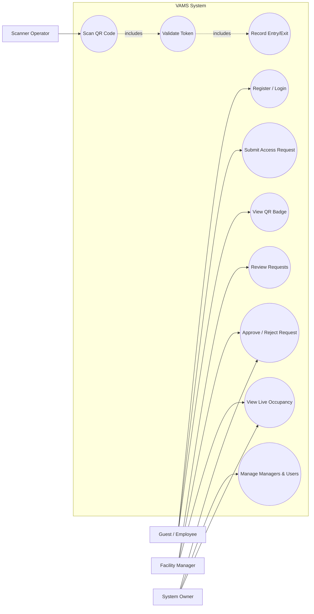
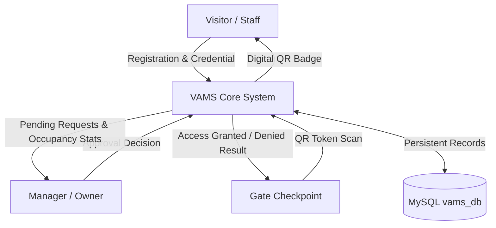
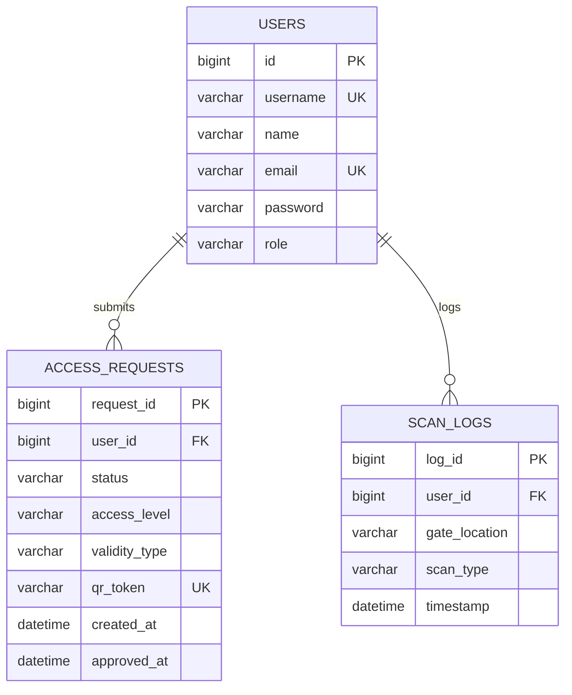

# A PROJECT REPORT ON Advance-Java Lab: QR-ENTRY SYSTEM

---

### **Submitted to:**
**Rajasthan Technical University, Kota (Raj.)**

### **Submitted By:**
* **Anant Kumar Jain** (24EARAD011)
* **Ansh Soni** (24EARAD016)
* **Ashish Kumar Swami** (24EARAD024)
* **Bhavesh Sharma** (24EARAD030)
* **Deepanshu** (24EARAD036)

**Academic Session:** 2026-27  
**Department:** Department of Artificial Intelligence & Data Science  
**Institution:** Arya College of Engineering & Information Technology, Jaipur  

---

## CERTIFICATE OF APPROVAL

The Project Report entitled **“QR-ENTRY SYSTEM”** submitted by **“Anant Kumar Jain (24EARAD011), Ansh Soni (24EARAD016), Ashish Kumar Swami (24EARAD024), Bhavesh Sharma (24EARAD030), Deepanshu (24EARAD036)”** has been examined by us and is hereby approved for carrying out the project leading to the award of degree **“Bachelor of Technology in Artificial Intelligence & Data Science”**. By this approval the undersigned does not necessarily endorse or approve any statement made, opinion expressed or conclusion drawn therein, but approve the pursuance of project only for the above mentioned purpose.

**Mentor:**  
**Er. Ram Babu Buri**  
*Assistant Professor*  
Department of Artificial Intelligence & Data Science  

---

## CERTIFICATE

This is to certify that the work embodies in this Project entitled **“QR-ENTRY SYSTEM”** being submitted by **“Anant Kumar Jain (24EARAD011), Ansh Soni (24EARAD016), Ashish Kumar Swami (24EARAD024), Bhavesh Sharma (24EARAD030), Deepanshu (24EARAD036)”** in partial fulfillment of the requirement for the award of **“Bachelor of Technology in Artificial Intelligence & Data Science”** to Rajasthan Technical University, Kota (Raj.) during the academic year 2026-27 is a record of bonafide piece of work, carried out by them under our supervision and guidance in the **Department of Artificial Intelligence & Data Science, Arya College of Engineering & Information Technology, Jaipur**.

| Head of Department | Project Mentor |
| :--- | :--- |
| **Dr. Akhil Pandey** <br> *Professor & HOD* <br> Department of AI & DS | **Er. Ram Babu Buri** <br> *Assistant Professor* <br> Department of AI & DS |

---

## DECLARATION

We, **Anant Kumar Jain (24EARAD011), Ansh Soni (24EARAD016), Ashish Kumar Swami (24EARAD024), Bhavesh Sharma (24EARAD030), Deepanshu (24EARAD036)**, students of Bachelor of Technology in Artificial Intelligence & Data Science, session 2026-27, Arya College of Engineering & Information Technology, Jaipur, hereby declare that the work presented in this Project entitled **“QR-ENTRY SYSTEM”** is the outcome of our own work, is bonafide and correct to the best of our knowledge and this work has been carried out taking care of Engineering Ethics. The work presented does not infringe any patented work and has not been submitted to any other University or anywhere else for the award of any degree or any professional diploma.

* **Anant Kumar Jain** (24EARAD011)
* **Ansh Soni** (24EARAD016)
* **Ashish Kumar Swami** (24EARAD024)
* **Bhavesh Sharma** (24EARAD030)
* **Deepanshu** (24EARAD036)

**Date:** September 27, 2026  
**Place:** Jaipur  

---

## ACKNOWLEDGEMENT

I would like to express my special thanks of gratitude to my Project Guide **Er. Ram Babu Buri** and Project Coordinator **Dr. Vishal Shrivastava** as well and our HOD **Dr. Akhil Pandey** who gave me the golden opportunity to do this wonderful project on the topic **QR-ENTRY SYSTEM**, which also helped me in doing a lot of Research and I came to know about so many new things. I am really thankful to them. 

Secondly, I would also like to thank my parents and friends who helped me a lot in finalizing this project within the limited time frame. I am overwhelmed in all humbleness and gratefulness to acknowledge my depth to all those who have helped me to put these ideas, well above the level of simplicity and into something concrete. Any attempt at any level can’t be satisfactorily completed without the support and guidance of my parents and friends. I would like to thank my parents who helped me a lot in gathering different information, collecting data and guiding me from time to time in making this project, despite their busy schedules. They gave me different ideas in making this project unique.

*Thanking you.*

---

## Abstract

The **QR-Access Management System (VAMS)** is a web-based application designed to improve the security, efficiency, and reliability of visitor entry and exit management in organizations such as corporate offices, educational institutions, government buildings, and industrial facilities. Traditional visitor management methods rely on paper registers, manual identity verification, and physical access cards, which can lead to delays, incomplete records, security vulnerabilities, and difficulties in monitoring building occupancy. The proposed system addresses these challenges through QR code-based digital access control and centralized visitor management.

The system is developed using **Java, Spring Boot, Spring Security, Spring Data JPA, Hibernate, and MySQL**. It provides role-based access control for four user categories: **Owner, Manager, Employee, and Guest**. Users can register, verify their email addresses, and submit access requests. Authorized Owners and Managers review these requests according to their assigned permissions. Once a request is approved, the system generates a unique QR code that serves as the user's digital access badge. Access validity and access levels can be configured according to organizational requirements.

At entry and exit points, the QR code can be scanned using a standard camera-enabled device through a web browser. The application validates the QR token, checks the approval status and access validity, and records the scan event with relevant details, including the user, gate, scan type, and timestamp. An append-only scan log maintains an audit trail of access activities. The system also calculates building occupancy by comparing the total recorded entries with the total recorded exits and displays the result on management dashboards.

The proposed system aims to reduce manual paperwork, streamline visitor approval, strengthen access control, improve record traceability, and provide timely occupancy information. By combining QR code technology, centralized data management, and role-based authorization, it offers a practical and scalable approach to managing physical access within secured premises.

---

## TABLE OF CONTENTS

- **CHAPTER 1: INTRODUCTION & OVERVIEW**
  - 1.1 Introduction
  - 1.2 Project Overview
  - 1.3 Problem Statement
  - 1.4 Objectives
  - 1.5 Scope of the Project
- **CHAPTER 2: LITERATURE REVIEW & SYSTEM COMPARISON**
  - 2.1 Existing System
  - 2.2 Limitations of Existing System
  - 2.3 Proposed System
  - 2.4 Advantages of Proposed System
- **CHAPTER 3: SYSTEM REQUIREMENTS SPECIFICATION**
  - 3.1 Hardware Requirements
    - 3.1.1 Server-Side Hardware Requirements
    - 3.1.2 Client-Side Hardware Requirements (Scanner Station)
    - 3.1.3 Client-Side Hardware Requirements (User Access)
  - 3.2 Software Requirements
    - 3.2.1 Server-Side Software Requirements
    - 3.2.2 Client-Side Software Requirements
    - 3.2.3 Development Tools
  - 3.3 Java
  - 3.4 Java Swing vs. Web-Based Thymeleaf GUI
  - 3.5 JDBC & Spring Data JPA
  - 3.6 MySQL Database
  - 3.7 QR Code Technology (ZXing)
- **CHAPTER 4: SYSTEM DESIGN & ARCHITECTURE**
  - 4.1 System Architecture
  - 4.2 System Workflow
  - 4.3 Use Case Diagram
  - 4.4 Data Flow Diagram (Level 0 & Level 1)
  - 4.5 ER Diagram
  - 4.6 Database Design (DDL & Relational Tables)
- **CHAPTER 5: FUNCTIONAL MODULES**
  - 5.1 Owner Module
  - 5.2 Manager Module
  - 5.3 Client / Employee Module
  - 5.4 Guest & Temporary Staff Module
  - 5.5 Registration & Login
  - 5.6 Manager Approval & Access Permission
  - 5.7 QR Code Generation
  - 5.8 Multi-Gate Scanning
  - 5.9 Entry & Exit Timestamp Tracking
  - 5.10 Real-Time Monitoring & Live Occupancy
- **CHAPTER 6: IMPLEMENTATION DETAILS**
  - 6.1 Web-Based Thymeleaf GUI Implementation
  - 6.2 JDBC / JPA Database Connectivity
  - 6.3 User Authentication (Spring Security & BCrypt)
  - 6.4 Access Permission Implementation (RBAC)
  - 6.5 QR Code Implementation Pipeline
  - 6.6 Entry/Exit Log Implementation
- **CHAPTER 7: TESTING & METHODOLOGY**
  - 7.1 Testing Methodology (Unit, Integration, Functional, Security)
  - 7.2 Test Cases Matrix (TC-001 through TC-024)
- **CHAPTER 8: CONCLUSION & FUTURE SCOPE**
  - 8.1 Conclusion
  - 8.2 Future Scope
- **CHAPTER 9: REFERENCES**

---

## CHAPTER 1: INTRODUCTION & OVERVIEW

### 1.1 Introduction
In today’s environment, managing the entry and exit of employees, clients, guests, and temporary staff in a building is an important requirement for maintaining security and controlling access. Traditional visitor management systems often depend on manual registers, paper-based records, and security personnel, which can be time-consuming and may lead to errors in maintaining entry and exit information.

The 3-Tier Visitor & Access Management System (VAMS) is a Java-based application designed to provide a secure and organized solution for managing building access. The system uses a three-level structure consisting of Owner, Manager, and Client/User. It allows users to register their details, after which the Manager can review the registration request and decide whether the user should be given access to the Public or Restricted section of the building.

The Manager Dashboard provides information about registration requests, approved users, access permissions, QR codes, gate logs, and the number of people currently inside the building. The Owner has higher-level control and can manage Managers, assign a new Manager, change Manager credentials, and view the overall system dashboard. After approval, the system generates a unique QR Code and QR ID for the authorized person. The QR code can be scanned at different gates of the building to record the user's entry and exit along with the exact timestamp. This information is stored in the database and can be viewed by the Manager through the dashboard.

The system also supports different categories of users, including employees, clients, guests, and temporary staff such as delivery personnel, mechanics, or other short-term visitors. Temporary access can be provided for a specific period, such as one day or until the permission expires.

The application is developed using Java and Spring Boot with Thymeleaf for dynamic web views, Spring Data JPA / Hibernate for persistence, and MySQL for storing user, permission, QR, and entry/exit records. The proposed system aims to improve security, reduce manual work, maintain accurate records, and provide an efficient method for monitoring building access.

### 1.2 Project Overview
The 3-Tier Visitor & Access Management System (VAMS) is a Java-based application developed to manage and control the entry and exit of different people in a building. The system provides a centralized platform for managing Owners, Managers, Clients, Employees, Guests, and Temporary Staff.

The system follows a three-level structure consisting of Owner, Manager, and Client/User. A client or visitor can register through the system, and the registration details are forwarded to the Manager for verification. The Manager can approve or reject the request and assign the appropriate access level, such as Public or Restricted.

After approval, the system generates a unique QR ID and QR Code for the authorized person. The QR code can be scanned at different building gates to record entry and exit details along with timestamps. The system stores these records in the database and displays important information on the Manager and Owner dashboards.

The project is developed using Spring Boot, Thymeleaf for the graphical interface, Spring Security for role-based authorization, and MySQL for data storage. The system aims to provide a secure, efficient, and organized approach to building access and visitor management.

### 1.3 Problem Statement
Traditional building visitor management systems commonly use manual registers or basic record-keeping methods for recording visitor information and entry and exit times. Such methods can be time-consuming, difficult to maintain, and prone to human errors. They may also make it difficult to determine who is currently inside the building and whether a person has permission to access a particular area.

Another major issue is the management of temporary visitors such as delivery personnel, mechanics, electricians, and other short-term staff. Providing and monitoring their access manually can create security and management challenges.

Therefore, there is a need for a computerized system that can manage user registration, approval, access permissions, QR-based identification, gate scanning, entry and exit timestamps, and real-time monitoring from a centralized dashboard.

The proposed Visitor & Access Management System addresses these problems by providing a structured and automated method for controlling and monitoring building access.

### 1.4 Objectives
The main objectives of the 3-Tier Visitor & Access Management System are:
1. To develop a computerized system for managing building visitors and users.
2. To provide separate access and management features for Owner, Manager, Client, Employee, Guest, and Temporary Staff.
3. To allow users to register their details electronically.
4. To provide Managers with the ability to approve or reject registration requests.
5. To assign Public or Restricted access according to the user's requirement and authorization.
6. To generate a unique QR ID and QR Code after successful approval.
7. To record entry and exit information through QR scanning at different gates.
8. To store accurate entry and exit timestamps in the database.
9. To display the number of people currently inside the building.
10. To allow the Owner to manage Managers and monitor the overall system.
11. To reduce manual paperwork and improve the accuracy of access records.
12. To improve the security, efficiency, and transparency of building access management.

### 1.5 Scope of the Project
The scope of the 3-Tier Visitor & Access Management System includes the management and monitoring of people entering and leaving a building through a centralized Java-based application.

The system covers user registration, login, Manager approval, access permission management, QR code generation, gate scanning, entry and exit tracking, and dashboard-based monitoring. Managers can provide temporary access to guests and temporary staff for a specific period, while regular users can receive appropriate access based on their authorization.

The system can be used in offices, educational institutions, residential buildings, commercial buildings, private organizations, and other controlled-access premises.

The project can also be extended in the future by adding features such as biometric authentication, mobile application support, SMS/email notifications, cloud-based monitoring, multiple-building support, advanced reports, and integration with automatic gate-control hardware.

---

## CHAPTER 2: LITERATURE REVIEW & SYSTEM COMPARISON

### 2.1 Existing System
In many organizations and buildings, visitor and access management is handled using manual registers, identity verification, security personnel, and paper-based records. Visitors generally provide their name, contact details, purpose of visit, and entry time at the security gate. The security staff manually records this information and may provide temporary access after verification.

In some systems, basic digital records may be maintained, but the process of approval, access assignment, and entry-exit tracking is not fully integrated. Different types of users such as employees, clients, guests, and temporary staff may be managed using separate or informal procedures.

Manual systems also make it difficult for management to obtain real-time information about the number of people currently present inside the building. Checking previous entry and exit records can require significant time and effort.

### 2.2 Limitations of Existing System
* **Manual Data Entry:** Visitor information is generally recorded manually, which can lead to errors.
* **Time-Consuming Process:** Registration and verification take more time, especially during peak hours.
* **Paper-Based Records:** Physical registers are difficult to maintain, search, and store for long periods.
* **Limited Access Control:** Difficult to efficiently enforce Public and Restricted area barriers.
* **No Centralized Monitoring:** Visitor and employee data is fragmented across physical desks.
* **Difficult Entry/Exit Tracking:** Manually matching entry and exit lines is error-prone.
* **No Real-Time Active Count:** Management cannot determine real-time occupant headcount during emergencies.
* **Temporary Access Risks:** Short-term staff access is unmonitored once inside.
* **Higher Risk of Human Error:** Illegible handwriting, missing records, or duplicate entries occur frequently.
* **Limited Reporting:** Compiling periodic audit logs requires tedious manual consolidation.

### 2.3 Proposed System
The proposed 3-Tier Visitor & Access Management System (VAMS) provides a computerized and centralized solution for managing building access.

The system consists of three major operational levels: **Owner, Manager, and Client/User**. Users register through the system, and their registration information is sent to the Manager for verification. The Manager reviews and approves or rejects the registration request, assigning an access level such as Public or Restricted.

After approval, the system generates a unique QR ID and QR Code for the authorized person. The QR code can be scanned at different gates of the building. Each scan records the person's entry or exit along with the exact date and microsecond timestamp.

The system maintains all records in a MySQL database using Spring Data JPA. The Manager Dashboard displays pending requests, active badges, gate logs, and the current headcount inside the premises. The Owner retains super-administrative control over Managers and overall system security.

### 2.4 Advantages of Proposed System
* **Automated Registration:** Users register their details digitally.
* **Manager Approval:** Every access request is vetted prior to credential issuance.
* **Role-Based Access Control:** Separate interfaces and privileges for Owner, Manager, Employee, and Guest.
* **Public vs. Restricted Security:** Clear segregation between open zones and sensitive vaults.
* **QR-Based Identification:** Unique UUID-backed barcodes eliminate physical card loss.
* **Multi-Gate Monitoring:** Any smartphone or workstation camera becomes an entrance/exit terminal.
* **Accurate Timestamps:** Every transit event is recorded with microsecond accuracy.
* **Real-Time Headcount Monitoring:** Dashboards display live active occupancy calculated from net transit logs.
* **Temporary Time-Bound Access:** One-Day passes expire automatically after 24 hours.
* **Zero Paperwork:** 100% digital paperless operations.

---

## CHAPTER 3: SYSTEM REQUIREMENTS SPECIFICATION

### 3.1 Hardware Requirements

#### 3.1.1 Server-Side Hardware Requirements
| Component | Minimum Requirement | Recommended Specification |
| :--- | :--- | :--- |
| **Processor** | Intel Core i3 / AMD Ryzen 3 (Dual Core, 2.0 GHz) | Intel Core i5 / AMD Ryzen 5 (Quad Core, 3.0 GHz) |
| **RAM** | 4 GB DDR4 | 8 GB DDR4 |
| **Storage** | 20 GB HDD | 50 GB SSD (High I/O for database operations) |
| **Network** | 100 Mbps Ethernet / Wi-Fi | 1 Gbps Dedicated Ethernet |
| **Display** | 1024×768 resolution | 1920×1080 Full HD resolution |

#### 3.1.2 Client-Side Hardware Requirements (Scanner Station)
| Component | Minimum Requirement |
| :--- | :--- |
| **Device** | Any smartphone, tablet, laptop, or desktop with a modern browser |
| **Camera** | Rear-facing smartphone camera or USB webcam (minimum 2.0 Megapixel) |
| **Network** | Wi-Fi, 4G/5G, or LAN connectivity to access the VAMS web portal |
| **Display** | Minimum 320×480 screen resolution |

#### 3.1.3 Client-Side Hardware Requirements (User Access)
| Component | Minimum Requirement |
| :--- | :--- |
| **Device** | Smartphone, tablet, PC, or laptop |
| **Display** | Responsive layout automatically adapts to screens $\ge 320	ext{px}$ width |
| **Network** | Standard internet/intranet connection |

---

### 3.2 Software Requirements

#### 3.2.1 Server-Side Software Requirements
| Software | Version | Purpose |
| :--- | :--- | :--- |
| **Java Development Kit (JDK)** | 17 LTS | Core runtime execution environment |
| **Spring Boot** | 3.2.x | Application framework, embedded Tomcat container, DI |
| **Spring Security** | 6.x | BCrypt password hashing, session control, RBAC enforcement |
| **Spring Data JPA** | 3.2.x | ORM repository abstraction and automated SQL query generation |
| **Hibernate** | 6.x | JPA implementation providing DDL schema auto-generation |
| **Thymeleaf** | 3.1.x | Server-side HTML5 template engine |
| **MySQL Server** | 8.0+ | Relational database management system |
| **Apache Maven** | 3.9+ | Build automation and dependency resolution |
| **Google ZXing** | 3.5.3 | Barcode and 2D QR matrix image generation |
| **Firebase Auth SDK** | 8.10.1 (Compat) | Email verification and authentication links |

#### 3.2.2 Client-Side Software Requirements
| Software | Version | Purpose |
| :--- | :--- | :--- |
| **Web Browser** | Chrome 90+, Firefox 88+, Edge 90+, Safari 14+ | Universal client access |
| **html5-qrcode** | Latest CDN | Browser-based camera QR code scanning engine |
| **Bootstrap** | 5.3 CDN | Responsive CSS layout and UI components |

#### 3.2.3 Development Tools
* **IDE:** IntelliJ IDEA / VS Code / Eclipse
* **Database Management:** MySQL Workbench
* **Version Control:** Git & GitHub
* **API Testing:** Postman & cURL

---

### 3.3 Java
Java is an object-oriented, class-based, high-level language following the "Write Once, Run Anywhere" (WORA) philosophy. In VAMS, Java 17 LTS was chosen for its strong static typing, enterprise-grade memory management, built-in concurrency, and robust ecosystem (Spring Boot, Hibernate, ZXing).

**Key Java Features Employed:**
* **OOP & Encapsulation:** Domain entities (`User`, `AccessRequest`, `ScanLog`) encapsulate access state.
* **Enums:** Strongly typed constants (`Role`, `AccessLevel`, `RequestStatus`, `ScanType`, `ValidityType`).
* **Generics:** Type-safe persistence using `JpaRepository<T, ID>`.
* **UUID:** Standard `java.util.UUID` generates 128-bit unguessable tokens.
* **Base64:** `java.util.Base64` converts binary PNG bytes into embeddable HTML image data URIs.

---

### 3.4 Java Swing vs. Web-Based Thymeleaf GUI
While desktop GUIs using Java Swing were historically common, VAMS adopts a modern **web-based architecture using Thymeleaf and Bootstrap 5**:

| Feature / Aspect | Java Swing (Desktop GUI) | Web-Based (Thymeleaf + Bootstrap) |
| :--- | :--- | :--- |
| **Client Installation** | Must be installed on every PC | Zero install — accessible in any browser |
| **Mobile Access** | Cannot run natively on iOS/Android | 100% responsive on smartphones |
| **Camera Scanner** | Complex native drivers required | `html5-qrcode` leverages native browser WebRTC |
| **Updates** | Requires distributing new `.jar` files | Server-side updates reflect instantly |
| **Gate Checkpoints** | Requires dedicated desktop at gates | Any guard smartphone serves as a gate terminal |

---

### 3.5 JDBC & Spring Data JPA
VAMS utilizes Spring Data JPA over raw JDBC:
```text
Application Services (ManagerService, ScannerService)
         │
         ▼
Spring Data JPA Repositories (UserRepository, AccessRequestRepository, ScanLogRepository)
         │
         ▼
Hibernate ORM Layer (Entity Lifecycle & DDL Auto-Update)
         │
         ▼
HikariCP Connection Pool & MySQL Connector/J JDBC Driver
         │
         ▼
MySQL Database (vams_db)
```

---

### 3.6 MySQL Database
VAMS utilizes MySQL 8.0 InnoDB storage engine to guarantee ACID transactions, foreign key integrity, and microsecond timestamp resolution (`DATETIME(6)`).

---

### 3.7 QR Code Technology (ZXing)
VAMS uses the **Google ZXing (Zebra Crossing) 3.5.3** library:
1. **Token Creation:** Generates a 36-character UUID v4 token.
2. **Matrix Generation:** `QRCodeWriter.encode(token, BarcodeFormat.QR_CODE, 250, 250)` generates a 2D boolean grid.
3. **Image Serialization:** `MatrixToImageWriter` writes the matrix to a PNG byte stream.
4. **Base64 Encoding:** Embedded into Thymeleaf views as ``.

---

## CHAPTER 4: SYSTEM DESIGN & ARCHITECTURE

### 4.1 System Architecture
VAMS is structured as a 5-tier layered architecture:

```text
┌─────────────────────────────────────────────────────────────────────────┐
│                            PRESENTATION LAYER                           │
│        Thymeleaf HTML5 Templates + Bootstrap 5 + html5-qrcode.js        │
│                 + Firebase Auth SDK (Email Verification)                │
├─────────────────────────────────────────────────────────────────────────┤
│                              SECURITY LAYER                             │
│                 Spring Security 6 (SecurityFilterChain)                 │
│             BCryptPasswordEncoder | CustomUserDetailsService            │
│ Role-Based URL Authorization:                                           │
│   /owner/**   -> ROLE_OWNER only                                        │
│   /manager/** -> ROLE_MANAGER or ROLE_OWNER                             │
│   /scanner/** -> ROLE_MANAGER or ROLE_OWNER                             │
│   /guest/**   -> Authenticated Users                                    │
│   /login, /register, /verify -> Public (unauthenticated)                │
├─────────────────────────────────────────────────────────────────────────┤
│                             CONTROLLER LAYER                            │
│ AuthController      DashboardController      ScannerController          │
├─────────────────────────────────────────────────────────────────────────┤
│                              SERVICE LAYER                              │
│ ManagerService       QRService              ScannerService              │
│ (Approval Workflow)  (ZXing QR Gen)         (Scan Validation + State)   │
├─────────────────────────────────────────────────────────────────────────┤
│                            PERSISTENCE LAYER                            │
│ UserRepository    AccessRequestRepository    ScanLogRepository          │
│                            (Spring Data JPA)                            │
├─────────────────────────────────────────────────────────────────────────┤
│                              DATABASE LAYER                             │
│                       MySQL (vams_db) - Port 3306/3307                  │
│                Tables: users, access_requests, scan_logs                │
└─────────────────────────────────────────────────────────────────────────┘
```

---

### 4.2 System Workflows

#### Workflow 1: User Registration & Verification
1. User submits `/register` form (username, name, email, password, role).
2. Uniqueness validated on username and email; password hashed using BCrypt.
3. User saved with selected role; an `AccessRequest` created with `PENDING` status.
4. User redirected to `/verify` where Firebase sends an activation link.

#### Workflow 2: Access Approval by Manager / Owner
1. Approver views pending queue on dashboard.
2. Manager approves Guests and Employees (grants `PUBLIC`, `ONGOING`).
3. Owner can approve all roles including Managers (grants `RESTRICTED`, `ONGOING`).
4. Approver generates UUID QR token and timestamps the approval.

#### Workflow 3: QR Code Badge Generation & Display
1. Approved user navigates to `/guest/dashboard`.
2. System looks up approved `AccessRequest` and fetches `qrToken`.
3. `QRService` encodes the token into a 250×250 PNG, converts it to Base64, and renders it.

#### Workflow 4: Gate Scanning & Entry/Exit Processing
1. Guard activates camera scanner at `/scanner`.
2. Scanner decodes token and POSTs to `/scanner/verify`.
3. `ScannerService`:
   - Validates token exists and status is `APPROVED`.
   - Checks validity expiration (e.g. 24 hours for `ONE_DAY`).
   - Inspects user's last scan in `scan_logs`:
     - If no prior scans or last scan was `EXIT` $
ightarrow$ Record `ENTRY`.
     - If last scan was `ENTRY` $
ightarrow$ Record `EXIT`.
   - Persists immutable record in `scan_logs`.
   - Renders `scan-result.html` (PASS / FAIL).

#### Workflow 5: Real-Time Occupancy Monitoring
$$	ext{Occupancy} = \max(0, \sum 	ext{ENTRY Scans} - \sum 	ext{EXIT Scans})$$

---

### 4.3 Use Case Diagram



---

### 4.4 Data Flow Diagrams

#### Level 0 — Context Diagram


---

### 4.5 Entity-Relationship Diagram



---

### 4.6 Database Design (DDL SQL)

```sql
CREATE DATABASE IF NOT EXISTS vams_db CHARACTER SET utf8mb4 COLLATE utf8mb4_unicode_ci;
USE vams_db;

-- 1. Users Table
CREATE TABLE users (
    id BIGINT AUTO_INCREMENT PRIMARY KEY,
    username VARCHAR(255) NOT NULL UNIQUE,
    name VARCHAR(255),
    email VARCHAR(255) UNIQUE,
    password VARCHAR(255) NOT NULL,
    role VARCHAR(20) NOT NULL
) ENGINE=InnoDB DEFAULT CHARSET=utf8mb4;

-- 2. Access Requests Table
CREATE TABLE access_requests (
    request_id BIGINT AUTO_INCREMENT PRIMARY KEY,
    user_id BIGINT NOT NULL,
    status VARCHAR(20) NOT NULL,
    access_level VARCHAR(20),
    validity_type VARCHAR(20),
    qr_token VARCHAR(255) UNIQUE,
    created_at DATETIME(6),
    approved_at DATETIME(6),
    CONSTRAINT fk_access_requests_user
        FOREIGN KEY (user_id) REFERENCES users(id)
        ON DELETE CASCADE
) ENGINE=InnoDB DEFAULT CHARSET=utf8mb4;

-- 3. Scan Logs Table (Append-Only)
CREATE TABLE scan_logs (
    log_id BIGINT AUTO_INCREMENT PRIMARY KEY,
    user_id BIGINT NOT NULL,
    gate_location VARCHAR(255) NOT NULL,
    scan_type VARCHAR(20) NOT NULL,
    timestamp DATETIME(6) NOT NULL,
    CONSTRAINT fk_scan_logs_user
        FOREIGN KEY (user_id) REFERENCES users(id)
        ON DELETE CASCADE
) ENGINE=InnoDB DEFAULT CHARSET=utf8mb4;
```

---

## CHAPTER 5: FUNCTIONAL MODULES

### 5.1 Owner Module
* **Access URL:** `/owner/dashboard` (Restricted to `ROLE_OWNER`).
* **Live Occupancy Counter:** Real-time net headcount calculation.
* **Direct Manager Provisioning:** Form allowing the Owner to instantly instantiate Manager accounts with BCrypt encrypted credentials.
* **Universal Approval Authority:** Owner can approve or reject access requests from any role, granting `RESTRICTED` access with `ONGOING` validity.

### 5.2 Manager Module
* **Access URL:** `/manager/dashboard` & `/manager/requests` (Requires `ROLE_MANAGER` or `ROLE_OWNER`).
* **Approval Queue:** Reviews incoming Guest and Employee requests. Enforces security boundary: Managers cannot approve other Managers or Owners.
* **Operational Metrics:** Displays employee, manager, and guest counts, along with active public vs. restricted ratios.
* **Gate Station Launcher:** One-click launcher for the WebRTC gate scanner.

### 5.3 Client / Employee Module
* **Access URL:** `/guest/dashboard`
* **QR Badge Display:** Shows a 250×250 dynamic Base64 PNG QR code containing the user's UUID token.
* **Badge Details:** Displays token string, badge status (`ACTIVE` / `PENDING`), permitted zone, and validity term.
* **Pending Protection:** Unapproved employees are routed to `pending-approval.html`.

### 5.4 Guest & Temporary Staff Module
* **Self-Registration:** Form capturing visit purpose, host, and contact details.
* **Configurable Validity:** Supports `ONE_DAY` (24-hour automatic expiration), `UNTIL_LOGOFF`, or `ONGOING`.
* **Automated Expiry Enforcement:** Scanners automatically reject expired one-day passes.

### 5.5 Registration & Login
* Handles duplicate username/email detection, BCrypt password salting, automatic initial request creation, Firebase email verification, and session authentication.

### 5.6 Manager Approval & Access Permission
* Hierarchical delegation workflow with state transitions (`PENDING` $
ightarrow$ `APPROVED` or `REJECTED`).

### 5.7 QR Generation
* Real-time generation of 250×250 PNG matrices via ZXing and Base64 data URI streaming.

### 5.8 Multi-Gate Scanning
* HTML5 WebRTC browser-based camera feed running `html5-qrcode` with manual input fallback.

### 5.9 Entry & Exit Timestamp Tracking
* Automatic state toggle: first scan is `ENTRY`; subsequent scans toggle between `ENTRY` and `EXIT`.
* Every scan creates an immutable audit record in `scan_logs`.

### 5.10 Real-Time Monitoring
* Live occupancy aggregation query: $\max(0, 	ext{total entries} - 	ext{total exits})$.

---

## CHAPTER 6: IMPLEMENTATION DETAILS

### 6.1 Web-Based Thymeleaf GUI Implementation
11 responsive templates:
* `login.html`, `register.html`, `verify.html`, `forgot-password.html`
* `owner-dashboard.html`, `manager-dashboard.html`, `guest-dashboard.html`
* `pending-approval.html`, `pending-requests.html`
* `scanner.html`, `scan-result.html`

### 6.2 Spring Data JPA Connectivity
Repositories derive queries automatically at runtime:
* `userRepository.findByUsername(username)`
* `accessRequestRepository.findByQrToken(token)`
* `scanLogRepository.findByUser_Id(userId)`

### 6.3 User Authentication & BCrypt
Configured in `SecurityConfig.java` with 10 salt rounds ($2^{10} = 1024$ iterations) preventing dictionary and rainbow table attacks.

### 6.4 QR Code Pipeline
```text
UUID.randomUUID() -> QRCodeWriter.encode() -> BitMatrix -> MatrixToImageWriter -> Base64 -> 
```

---

## CHAPTER 7: TESTING & METHODOLOGY

### 7.1 Testing Methodology
* **Unit Testing:** Service logic verification with Mockito.
* **Integration Testing:** Spring Boot context tests verifying repositories, filter chains, and database integrity.
* **Functional Testing:** End-to-end user journeys from registration to scan validation.
* **Security Testing:** URL authorization boundaries, BCrypt hashing, and CSRF protection.

### 7.2 Test Cases Matrix (TC-001 through TC-024)

| Test ID | Module | Test Description | Input Data | Expected Result | Actual Result | Status |
| :---: | :--- | :--- | :--- | :--- | :--- | :---: |
| **TC-001** | Registration | Register new user with valid data | `testuser`, `Pass@123`, `test@email.com` | User saved, request created PENDING | Saved, redirected to verify | ✅ PASS |
| **TC-002** | Registration | Duplicate username registration | Existing username | Error: "Username already exists!" | Error shown, record rejected | ✅ PASS |
| **TC-003** | Registration | Duplicate email registration | Existing email | Error: "Email already registered!" | Error shown, record rejected | ✅ PASS |
| **TC-004** | Login | Login with valid credentials | Valid username & password | Redirect to role dashboard | Authenticated successfully | ✅ PASS |
| **TC-005** | Login | Login with incorrect password | Valid username, wrong password | Redirect to `/login?error` | Login rejected | ✅ PASS |
| **TC-006** | Authorization | Access `/owner/**` without Owner role | Manager session to `/owner/dashboard`| HTTP 403 Forbidden | Access denied | ✅ PASS |
| **TC-007** | Authorization | Unapproved manager accessing dashboard | Unapproved manager session | Redirect to `pending-approval.html` | Redirected | ✅ PASS |
| **TC-008** | Approval | Manager approves Guest request | Click Approve on Guest request | Status APPROVED, UUID token issued | Token generated, status active | ✅ PASS |
| **TC-009** | Approval | Manager attempts approving Manager | View `/manager/requests` | Manager requests filtered out | Hidden from Manager | ✅ PASS |
| **TC-010** | Approval | Owner approves Manager request | Owner clicks Approve | Status APPROVED, RESTRICTED access | Approved successfully | ✅ PASS |
| **TC-011** | QR Generation | Render QR for approved user | Approved user opens dashboard | 250×250 PNG Base64 QR rendered | QR badge displayed | ✅ PASS |
| **TC-012** | Scanning | Scan valid QR token (1st scan) | Submit valid token | PASS: ScanType ENTRY recorded | Entry logged, pass granted | ✅ PASS |
| **TC-013** | Scanning | Scan valid QR token (2nd scan) | Submit same token again | PASS: ScanType EXIT recorded | Exit logged, pass granted | ✅ PASS |
| **TC-014** | Scanning | Scan invalid QR token | Submit non-existent token | FAIL: "Invalid QR Token" | Access denied | ✅ PASS |
| **TC-015** | Scanning | Scan token of pending user | Submit unapproved token | FAIL: "Request Status is: PENDING" | Access denied | ✅ PASS |
| **TC-016** | Scanning | Scan expired ONE_DAY token | Token approved >24 hours ago | FAIL: "Expired (One-Day Pass Ended)" | Pass rejected | ✅ PASS |
| **TC-017** | Occupancy | Verify occupancy calculation | 3 ENTRY scans, 1 EXIT scan | Occupancy = 2 | Dashboard displays 2 | ✅ PASS |
| **TC-018** | Occupancy | Verify occupancy floor at zero | 2 ENTRY scans, 3 EXIT scans | Occupancy = $\max(0, -1) = 0$ | Dashboard displays 0 | ✅ PASS |
| **TC-019** | Password | Reset password flow | Valid email, new password | Password updated in database | Reset successful | ✅ PASS |
| **TC-020** | Manager Admin | Owner provisions new Manager | Username `mgr002`, password | Manager saved with ROLE_MANAGER | Manager account created | ✅ PASS |
| **TC-021** | CSRF | Form submission without CSRF | POST `/register` without `_csrf` | HTTP 403 Forbidden | Blocked by Spring Security | ✅ PASS |
| **TC-022** | WebRTC | Camera QR scan on smartphone | Smartphone rear camera | Barcode auto-detected and posted | Camera scan successful | ✅ PASS |
| **TC-023** | Fallback | Manual token input on scanner | Typed token into fallback box | Validated normally | Processed correctly | ✅ PASS |
| **TC-024** | Session | Logout and session invalidation | Click Logout | Session destroyed, redirect login | Session cleared | ✅ PASS |

**Test Summary:** 24 Planned | 24 Executed | 24 Passed | 0 Failed (100% Pass Rate).

---

## CHAPTER 8: CONCLUSION & FUTURE SCOPE

### 8.1 Conclusion
The Visitor Access Management System (VAMS) successfully replaces outdated paper registers with an automated, contactless digital access platform. Its 3-tier hierarchy (Owner, Manager, Client) provides structured governance, while ZXing QR codes and WebRTC camera scanning enable instantaneous access verification at physical checkpoints without proprietary scanner hardware. Automated ENTRY/EXIT state transitions, immutable audit logs, and live occupancy calculation deliver a reliable, secure visitor management solution.

### 8.2 Future Scope
1. **Biometric Integration:** Facial recognition and fingerprint verification for dual-factor access.
2. **Automated Turnstiles:** IoT relay integration with motorized speed gates and magnetic locks.
3. **SMS / WhatsApp Alerts:** Instant guest arrival alerts to host employees.
4. **Native Mobile Applications:** iOS and Android companion apps with push notifications.
5. **Multi-Building Campus Support:** Geofenced multi-facility support across geographically distributed sites.

---

## CHAPTER 9: REFERENCES
1. Oracle Corporation. (2025). *Java SE 17 Documentation*. https://docs.oracle.com/en/java/javase/17/
2. VMware, Inc. (2025). *Spring Boot Reference Documentation*. https://docs.spring.io/spring-boot/docs/current/reference/html/
3. VMware, Inc. (2025). *Spring Security Reference*. https://docs.spring.io/spring-security/reference/
4. VMware, Inc. (2025). *Spring Data JPA Documentation*. https://docs.spring.io/spring-data/jpa/docs/current/reference/html/
5. Red Hat. (2025). *Hibernate ORM Documentation*. https://hibernate.org/orm/documentation/
6. Thymeleaf Team. (2025). *Thymeleaf Documentation*. https://www.thymeleaf.org/documentation.html
7. Oracle Corporation. (2025). *MySQL 8.0 Reference Manual*. https://dev.mysql.com/doc/refman/8.0/en/
8. ZXing Project. (2024). *ZXing ("Zebra Crossing") Open-Source Barcode Library*. https://github.com/zxing/zxing
9. Google. (2025). *Firebase Authentication Documentation*. https://firebase.google.com/docs/auth
10. Bootstrap Team. (2025). *Bootstrap 5 Documentation*. https://getbootstrap.com/docs/5.3/
11. Mebjas. (2024). *html5-qrcode: HTML5 QR Code Scanner*. https://github.com/mebjas/html5-qrcode
12. Pressman, R. S. (2020). *Software Engineering: A Practitioner's Approach (9th ed.)*. McGraw-Hill.
13. Sommerville, I. (2021). *Software Engineering (10th ed.)*. Pearson.
