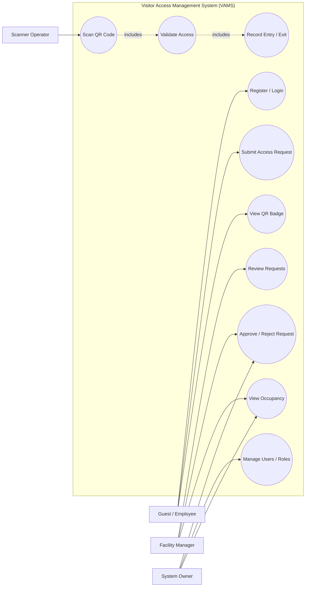
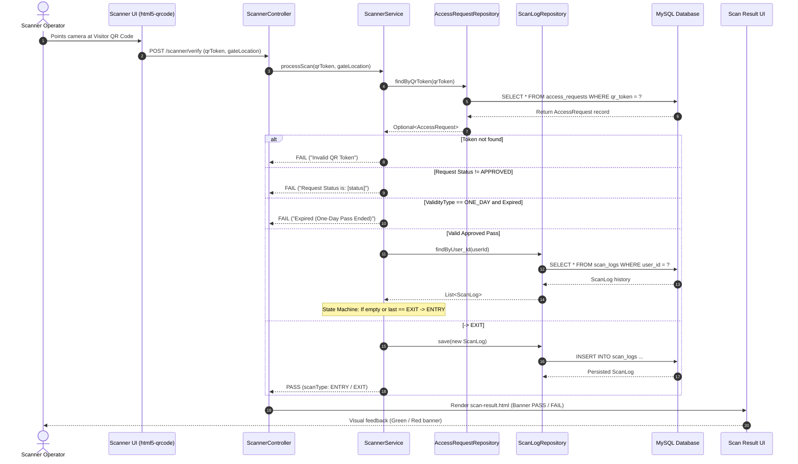
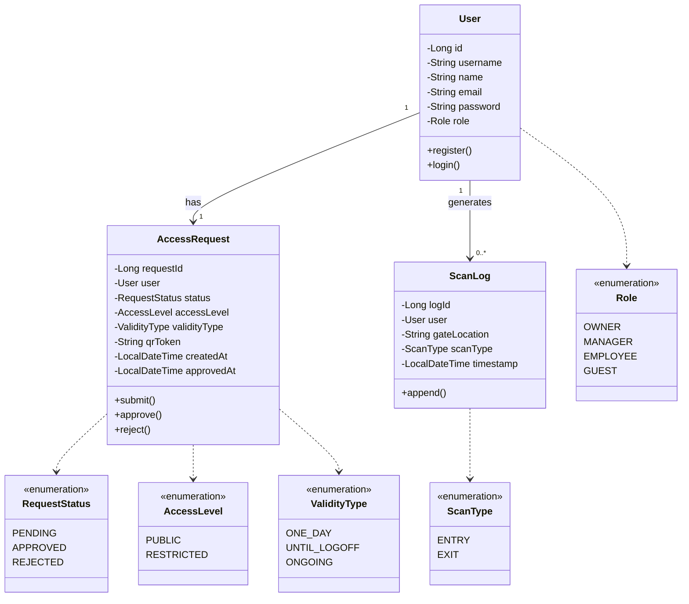
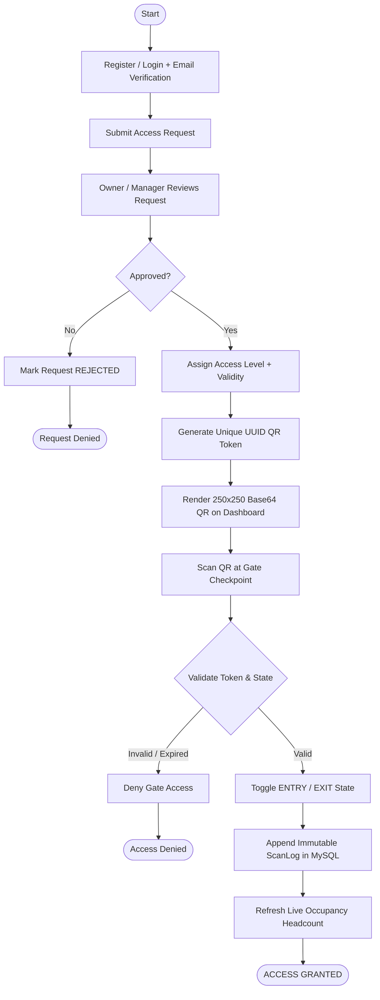
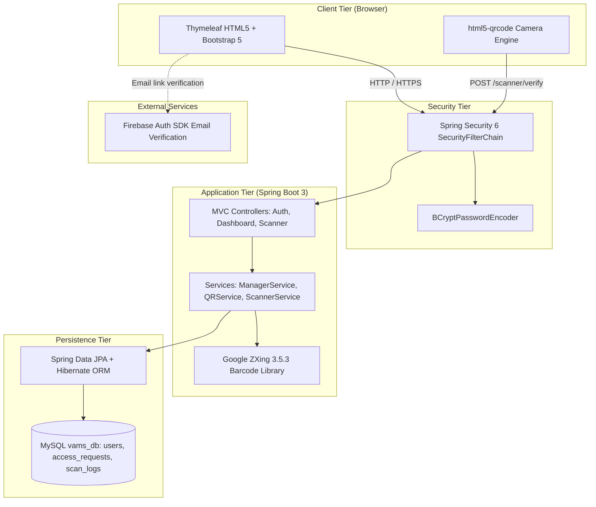

# UML DESIGN DOCUMENT
## QR-BASED VISITOR ACCESS MANAGEMENT SYSTEM (VAMS)

---

## 1. Use Case Diagram

**Actor Definitions:**
* **Guest / Employee:** Submits registration, accesses dashboard to view issued QR badge, presents badge at gates.
* **Manager:** Reviews pending requests for Employees/Guests, approves or rejects access, views live occupancy.
* **Owner:** Super administrator; provisions Manager accounts, approves all role requests, manages global system parameters.
* **Scanner Operator:** Operates gate checkpoint camera; scans QR codes to validate entry/exit.

---

## 2. Sequence Diagram — QR Scan Verification

---

## 3. Class Diagram — Core Domain Model

---

## 4. Activity Diagram — Registration, Approval & QR Access

---

## 5. Component Diagram — Application Architecture

